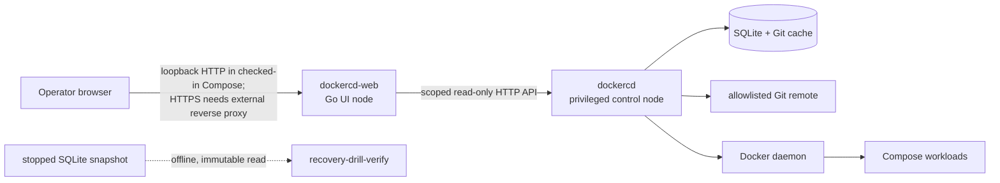

# DockerCD control node and Web node architecture

## Status and scope

This is a source-grounded architecture report for the repository at the
`8d8621a` tranche baseline. It describes code and the checked-in paired Compose
definition; this tranche did not start containers, inspect a Docker daemon, or
establish a live deployment state. The editable Mermaid source is
[`dockercd-control-web-architecture.mmd`](dockercd-control-web-architecture.mmd).

In this project, **Web node** means the separate `dockercd-web` Go process and
container—not a browser-only frontend. It authenticates a browser locally,
keeps the scoped controller credential on the server, requests a narrow typed
controller API, and server-renders HTML. It has no Docker socket, Git cache,
SQLite volume, or controller administrator token mount.



## Implemented component boundary

| Component | Language/process | Authority and owned data | Important interfaces |
| --- | --- | --- | --- |
| Control node (`dockercd serve`) | Go daemon; Cobra entry point wires API, reconciler, health/event monitors, Git sync, inspector, deployer, and SQLite store. | Privileged: Docker client/socket use, Compose subprocess deployment, Git credential/cache, manifest loading, SQLite state and migrations. | Authenticated legacy control API under `/api/v1`; separate scoped presentation GET API under `/api/v1/presentation/*`; webhook and optional SSE routes. |
| Web node (`dockercd-web`) | Separate Go `net/http` server with Go HTML templates, CSS, local authentication, and a typed `controlplane` client. | Unprivileged: process-local opaque browser sessions and per-session scoped controller credentials only. The browser never receives a controller bearer. | Browser GET/POST login/logout and read-only pages; server-to-server HTTP GET calls to the scoped presentation API with a 5-second default deadline and 1 MiB response limit. |
| SQLite state | Controller-owned `dockercd.db`, opened in WAL mode. | Applications, statuses, bounded sync history, and events. Web has no mount or direct query path. | Controller store interface; readiness uses a bounded database query. |
| Git/Compose reconciliation | Controller-owned Go Git synchronizer plus parser/differ/reconciler and Docker Compose deployer. | Allowed Git hosts and optional Git token; desired-state cache; deployment execution. | Reconciler schedules and serializes app work; it invokes inspection and `docker compose` only from the control node. |
| Offline recovery verifier | Go command `cmd/recovery-drill-verify`, not a service and not deployed in the pair. | Opens a stopped `dockercd.db` as immutable/read-only, emits redacted structural JSON evidence, and uses a private digest-only restore baseline. | CLI flags for database/application/revisions/baseline. It does not call Docker, Git, Web, or the controller API. |

The checked-in Compose definition implements two services on one dedicated
Compose bridge network; it is not declared `internal: true`. Both published
host ports are loopback-only. The control service gets
the Docker socket and the state volume; the Web service is read-only, drops all
Linux capabilities, uses `no-new-privileges`, and receives only its user
registry secret. The Web service points at `http://dockercd:8080` over the
dedicated Compose network. The checked-in Web container serves HTTP; its
required `DOCKERCD_WEB_PUBLIC_ORIGIN` is an HTTPS-origin validation input, not
TLS termination. Network-reachable browser access therefore needs a separately
configured TLS reverse proxy, which was not exercised in this tranche. This
Compose separation is not a hard security boundary if both services share one
Docker daemon; socket access remains host administrator equivalent.

## Request, status, and configuration flow

1. In the checked-in Compose example, the browser reaches the Web node over a
   loopback HTTP port. For network browser access, a separately configured TLS
   reverse proxy must terminate HTTPS before the Web node; the container does
   not implement TLS termination. Local authentication validates an Argon2id
   verifier from a provisioned users file, issues an opaque host-only cookie,
   and keeps the corresponding controller credential in process memory.
2. For a page request, the Web node's typed client makes only `GET` requests
   to `/api/v1/presentation/*`. It sends the scoped bearer server-to-server,
   rejects redirects, requires JSON, bounds the body, and maps result DTOs to
   server-rendered status pages.
3. The control node validates the opaque presentation credential, audience,
   expiry, capabilities, and resource grant. It has no fallback from a scoped
   credential to the legacy administrator API. The present scoped routes are
   capability-specific reads for capabilities, permissions, controller status,
   capacity, fleet, application, and activity.
4. Independently, the reconciler fetches desired state from an explicit Git
   host allowlist, parses and compares Compose state, persists status/history
   in SQLite, and invokes Docker inspection or Compose deployment from the
   control node only. The Web node does not trigger sync, rollback, Docker,
   Git, or direct state-store operations.
5. The recovery drill, when a separately authorized disposable daemon exists,
   stops the temporary controller before copying its state. The verifier then
   reads the copied snapshot offline. No live drill was run in this tranche.

## This tranche's placement and acceptance change

The selected change is inside the offline verifier only. Before this tranche,
the verifier accepted a required `(application, operation, result, commit)`
tuple when its SQL count was greater than zero. It now requires that each of
the four recovery evidence records appears exactly once: manual A, manual B,
successful rollback to A, and failed rollback to the generated unknown SHA.
That makes the design's one-time sequence an executable acceptance condition
without expanding the runtime API or Docker authority.

The verifier remains outside both nodes' runtime request path:

```text
stopped disposable snapshot -> immutable verifier -> redacted JSON evidence
                                  ^
                           exact-event check
```

## Implemented, planned, and incomplete

| Area | Evidence-based state | Gap / boundary |
| --- | --- | --- |
| Paired control/Web definition | Implemented in `deploy/docker-compose.yml` and separate Go modules. | This tranche did not verify a running pair or owner browser journey. |
| Scoped Web reads | Implemented in control API and Web typed client/local-auth code. | Browser mutation, generic proxying, broad logs, and live SSE presentation remain out of scope. |
| Control-node reconciliation | Implemented code wires Git, parsing, diffing, Docker inspection/deployment, health, event watching, and SQLite. | Live behavior depends on configured credentials, Git source, Docker daemon, and deployment context; none were exercised here. |
| Recovery drill runner | Implemented fixture/runner code and offline verifier. | Actual drill execution remains blocked until a purpose-built dedicated daemon and guard/protected contexts are available and preflight succeeds. |
| Bodhi touchpoint | Used only as a read-only, advisory local tranche-packet validator. | No DockerCD-to-Bodhi runtime integration, autonomous management, state write, model authority, or native/Core AI capability is claimed. |

## Source appendix

- `deploy/docker-compose.yml` — paired service topology, mounts, loopback
  ports, security options, secrets, and internal controller URL.
- `src/internal/cli/serve.go`, `src/internal/api/server.go`,
  `src/internal/reconciler/reconciler.go`, and `src/internal/store/store.go` —
  control-node process wiring, API authentication split, work scheduling, and
  persistence ownership.
- `web/cmd/dockercd-web/main.go`, `web/internal/controlplane/client.go`,
  `web/internal/presentation/live_source.go`, and
  `web/internal/localauth/authenticator.go` — Web-node local session boundary,
  typed scoped reads, and rendering data flow.
- `docs/presentation-integration-contract.md` and
  `docs/recovery-drill-design.md` — API and recovery acceptance contracts.
- `src/cmd/recovery-drill-verify/main.go` — offline exact-history verifier.

## Bodhi usage inventory and future heat map

This is an evidence-bounded inventory for this DockerCD tranche, not a
telemetry system or a claim about all assistant activity. The only verified
Bodhi invocation was the adjacent repository's local
`scripts/development-practice.mjs` validator, called with DockerCD's worktree
as its explicit repository root. It was used in read-only advisory mode; it
does not write Bodhi state, inspect Docker, grant acceptance, or manage
DockerCD.

| Project / tranche | Bodhi subsystem or tool | Observed invocation count | Outcome and effect | Duration / cost |
| --- | --- | ---: | --- | --- |
| DockerCD / exact recovery-history verifier | `bodhi-ai/scripts/development-practice.mjs` | 2 durably recorded validation entries: startup once; resume once | Confirmed the packet declaration shape and five hash-pinned local research sources were current. This affected the work only by validating the recorded workflow evidence; it did not approve the change. | Duration, token, model, monetary, and aggregate cost: unknown; this tranche has no durable measurement ledger. |

Direct assistant work is deliberately excluded from that table: repository
inspection, shell commands, `apply_patch` edits, Go compilation/tests/vet/race
checks, and the separate code review are not Bodhi tool invocations. A failed
attempt to address a non-existent relative validator path is also not counted
as a Bodhi call. The table counts only durably recorded validation evidence;
absent observed usage is not proof of comprehensive non-use outside that
evidence.

**Future work — not implemented or collected here:** an automated,
privacy-preserving heat map could have rows for verified tools/subsystems and
columns for project/tranche. It should record invocation frequency separately
from outcome (pass/fail/blocked) and separate both from human-assessed
usefulness or rework. It should retain only bounded operational metadata such
as tool identifier, timestamp bucket, tranche identifier, and outcome class;
it must not collect prompts, source/state contents, credentials, or Docker
data. Any instrumentation requires a separate design, data-governance review,
and owner authorization; it must not imply Bodhi autonomy or unpause its
native/Core AI work.
