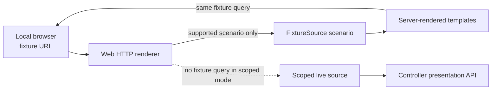

# Web fixture scenario continuity — architecture closure

## Implemented slice

The Web fixture review routes now keep the selected, supported scenario
(`healthy`, `stale`, or `error`) visible and intact while an operator follows
the existing read-only journey. The `Fixture mode` label identifies the active
scenario; primary navigation, application drill-down, refresh, and
fixture-only confirmation redirects retain it.

The editable source for this diagram is
[`web-fixture-scenario-review.mmd`](web-fixture-scenario-review.mmd).

## Boundary and data-flow assessment

This is not a controller or live-presentation contract change. The scenario is
an allow-listed query parameter consumed only by the existing fixture source.
It has no effect on a scoped live session: live rendering strips it from
navigation and refresh links, and the presentation API receives no new
parameter, credential, or request type. Fixture confirmations remain local
review behavior and still perform no controller action.

| Area | This tranche | Future / unchanged |
| --- | --- | --- |
| Browser UI | Names and preserves fixture evidence context; Safari/loopback fixture QA completed | Owner approval plus narrow-width review remain required |
| Web source | Reuses the immutable `FixtureSource` variants | Scoped live source and session boundary unchanged |
| Controller | No route, DTO, credential, or privilege change | Read-only presentation API remains the live boundary |
| Deployment | No image, Compose, network, or secret change | Live owner and restart validation remain release gates |

## Verification and remaining limits

Focused server-rendering tests cover the stale/error journey, confirmation
redirect, query-plus-fragment links, and the absence of fixture state in a
scoped live page.

On 2026-10-10, a Safari browser walkthrough used DockerCD's local loopback
fixture server only. It visually checked the healthy Fleet view, stale
`edge-api` drill-down, and controller-unavailable view. The displayed rail,
primary navigation, application links, and fixture refresh links carried the
selected scenario. The stale `Review fixture edit` path reached its explicit
confirmation screen and, after the fixture-only confirmation, redirected to
the application timeline with: `Fixture confirmation recorded for edit. No
controller operation was sent.` The browser content identified every checked
state as fixture data with no controller data or credentials in use.

The walk-through did **not** use Docker, a controller URL, a scoped live
session, credentials, or a deployment. It is visual evidence for fixture UX,
not live-controller validation. Safari's accessibility tree exposed the
`Skip to content` link on the checked routes; the native automation did not
surface a focused DOM element after a Tab press, so the visual focus ring was
not independently confirmed. No narrow browser-width capture was made because
the available native-browser harness could not safely resize the existing
Safari window. Narrow-width and light/dark owner review therefore remain open.

## Bodhi tool-use inventory

No Bodhi tool, runtime, repository, model, or file was used or changed for
this tranche. Direct assistant activity consisted of DockerCD source/design
inspection, local template and Go-test work, and this documentation. Those
activities are not Bodhi telemetry; their duration and cost are unknown.
